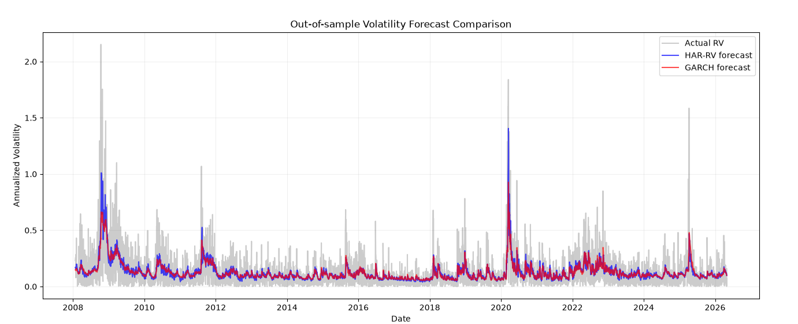
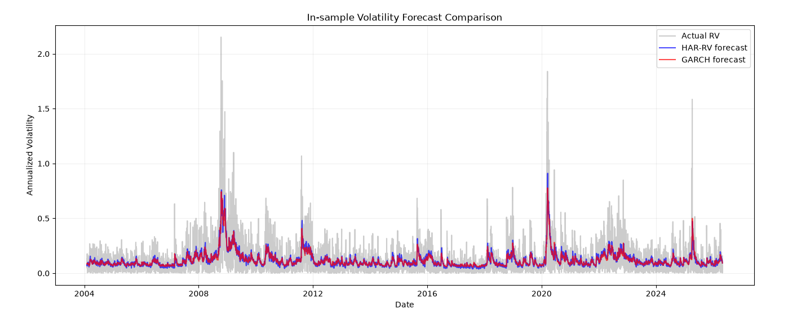

# Forecasting S&P 500 Realized Volatility: HAR-RV vs GARCH(1,1)

**Author:** Chunyang Tian
**Goal:** Compare two volatility forecasting models, HAR-RV (Corsi 2009) and GARCH(1,1) (Bollerslev 1986), to find out which model is better at predicting next-day realized volatility on S&P 500 data.

## Purpose & Outcome

This project want to answer one question: when we forecast tomorrow's market volatility, should we use the new approach (HAR-RV) or the classic approach (GARCH)?

Both models predict the same thing, tomorrow's volatility, but they use the data in very different ways. HAR-RV directly average the past volatility over 1, 5, and 21 days. GARCH instead use raw returns and update through a recursive formula. I run a strict out-of-sample test on SPY data from 2004 to 2026 to see which one give smaller error.

The main finding is that HAR-RV and GARCH are **statistically tied**. GARCH have a slightly lower out-of-sample MSE (2.5% lower), but the Diebold-Mariano test say this gap is not significant (p = 0.26). Both models beat a random-walk baseline by about 46%, so both of them do find real signal about tomorrow's volatility, and about the same amount.

## Data and Features

- SPY daily close price from Yahoo Finance, 2004-01-01 to 2026-05-01 (5595 days)
- Daily log return: log(Close_today / Close_yesterday)
- Realized volatility (RV): abs(Return) * sqrt(252)
- This is a simple proxy. The "true" RV need intraday data (5-minute returns), which I don't have free access to. This is a known limitation, and it turn out to matter more than I expect. See below.

## Methodology

### HAR-RV model

Use three features to predict today's RV:

- RV_d = yesterday's RV
- RV_w = past 5 days' RV average
- RV_m = past 21 days' RV average

All three features use .shift(1) to make sure we don't use today's RV to predict today's RV (look-ahead bias).

The model is just a linear regression:

$$RV_{today} \approx \beta_0 + \beta_d RV_d + \beta_w RV_w + \beta_m RV_m$$

The β weights are learned by ordinary least squares (OLS).

### GARCH(1,1) model

GARCH have a totally different idea. It assume today's variance can be written as:

$$\sigma^2_t = \omega + \alpha \varepsilon^2_{t-1} + \beta \sigma^2_{t-1}$$

where $\varepsilon$ is the return shock. This is recursive, yesterday's $\sigma^2$ contain the information from the day before, which contain the day before that, and so on. So GARCH actually use the entire history through this recursion, although older days have very small weight ($\beta^N$ decay).

The three parameters $(\omega, \alpha, \beta)$ are estimated by maximum likelihood. I use the arch python library.

### The scale problem: GARCH and HAR are not predicting the same thing

I missed this in my first version, and it changed the result.

GARCH give you $\sigma$, the conditional **standard deviation**. But my target is |r| * sqrt(252). These are not the same object. If $r = \sigma z$, then

$$E|r| = \sigma E|z| \ne \sigma$$

So if I compare raw $\sigma$ with |r|, the GARCH forecast is too big from the start.

HAR-RV don't have this problem, because it is a regression **on the target**. OLS just absorb the E|z| factor into the coefficients. GARCH don't get this, so I have to rescale it by hand.

Under a normal assumption, $E|z| = \sqrt{2/\pi} \approx 0.798$. But SPY return is fat-tailed, so instead of hard-coding that constant I estimate it from the GARCH standardized residuals on each training window:

```python
k_hat = np.mean(np.abs(garch_fit.std_resid))
```

On the full sample k_hat = **0.746**, below the Gaussian 0.798, which is what fat tails should do. I report the result under both constants, to check the conclusion don't depend on this choice.

### Out-of-sample test

For fair comparison, both models use exact same setup:

- Sliding window of 1000 days (about 4 years)
- Refit every single day (drop oldest day, add newest day)
- Predict only the next day (day t+1)
- Both forecast are put on the same scale, as explained above

I also add:

- **Random-walk baseline:** RV_tomorrow = RV_today. If a model can't beat this, it isn't doing anything.
- **Diebold-Mariano test** with Newey-West variance (5 lags), to check whether a MSE gap is real or just noise.

So the only difference left is the model itself.

## Result

### Out-of-sample MSE

| Model | MSE |
|---|---|
| GARCH (rolling k_hat) | **0.01674** |
| GARCH (Gaussian 0.798) | 0.01673 |
| HAR-RV | 0.01717 |
| Random walk baseline | 0.03170 |

### Diebold-Mariano test

| Comparison | DM | p-value | Result |
|---|---|---|---|
| HAR vs GARCH | +1.125 | 0.260 | **not significant** |
| HAR vs random walk | -8.124 | <0.0001 | significant |
| GARCH vs random walk | -8.556 | <0.0001 | significant |

(DM < 0 mean the first model have smaller squared error.)



### Reading the numbers

GARCH's MSE is 2.5% lower than HAR-RV, but the DM test say this is noise (p = 0.26). So my answer to the original question is: **on this data, with this proxy, the two models tie.**

The baseline comparison is not noise. Both models cut MSE by about 46% against "tomorrow = today".

The rolling k_hat and the Gaussian 0.798 give almost the same MSE (0.01674 vs 0.01673), so the result does not depend on assuming normality.

## Interpretation

**HAR coefficients.** The fitted weights are $\beta_d = -0.068$, $\beta_w = 0.556$, $\beta_m = 0.353$. The daily term get a small negative weight, and the weekly and monthly averages carry the prediction. This make sense: |r_yesterday| is one single draw of |z|, so it is very noisy. Averaging over 5 and 21 days gives the signal back.

**Why my R² is only 0.28.** Papers using intraday RV get a much higher R². I think the reason is my proxy: $|r| = \sigma |z|$ has a |z| noise term, and nobody can predict |z| even if they know $\sigma$ exactly. So a big part of the target can't be forecast with one observation per day.

**GARCH have long memory too.** The fitted persistence is $\alpha + \beta = 0.125 + 0.849 = 0.974$. So GARCH also carry long memory, just through exponential decay instead of HAR's 21-day window.

**Refit frequency.** In an earlier version I refit GARCH only every 21 days, and GARCH looked like it overfit much more. After I switched to daily refit for both models, that gap disappeared. So both models need the same window, refit schedule and forecast scale.



## Limitations

1. **RV proxy is rough.** I use abs(daily return) to approximate realized volatility. The standard in literature is 5-minute intraday returns, which is much less noisy. With intraday RV, HAR-RV may do better, since HAR was designed for that setting. So the tie here is about this proxy, not a general claim about the two models.

2. **The rescale assume z is iid.** Estimating E|z| from standardized residuals avoid assuming normality, but it still assume the standardized shocks have the same distribution across the training window.

3. **Only one-day horizon tested.** I only predict t+1. For multi-day forecast (like one-week ahead), GARCH can iterate forward, while HAR-RV need to be re-formulated.

4. **Only MSE loss.** Volatility forecasts are often evaluated with QLIKE, which is less sensitive to outliers in the target. The ranking could change under a different loss.

## Future Work

- Try with intraday data to get more accurate RV measure, and see if the tie hold
- Test multi-day horizon (k=5, k=21) where GARCH may pull ahead
- Add QLIKE loss beside MSE
- Combine with regime detection (my other project), see if the tie hold in different market regime (calm, volatile, crisis)

## How to Run

```bash
pip install yfinance pandas matplotlib numpy arch scikit-learn scipy
python HAR_RV.py
```

The script will print regression coefficients, GARCH parameters, the estimated k_hat, in-sample and out-of-sample MSE for all four forecasts, the Diebold-Mariano tests, and show two plots (in-sample and out-of-sample volatility forecast comparison).

Note the rolling loop refit GARCH on every one of about 4600 days, so a full run take several minutes.
